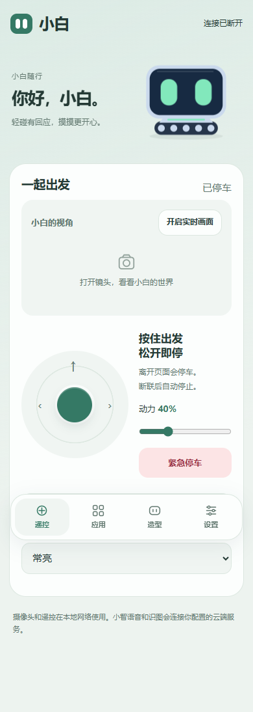
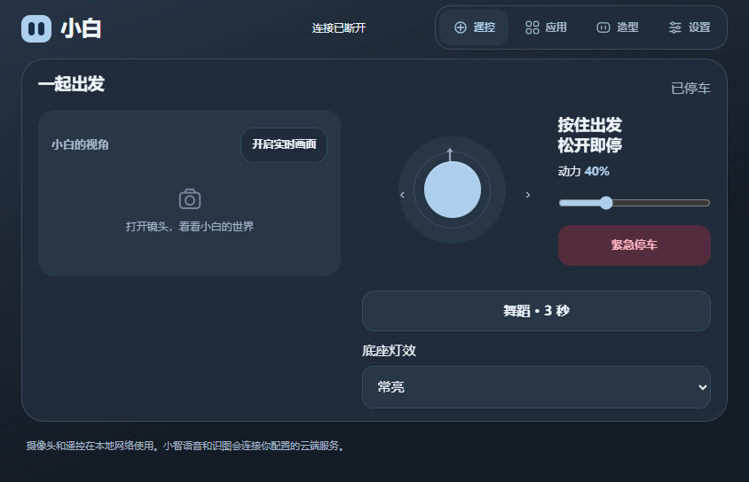

# 小白 · SparkBot 三合一

**能聊、能跑、能摸摸头的桌面小伙伴。**

小智对话 · 坦克遥控 · 木鱼与小游戏 · 双眼陪伴

[使用指南](docs/GETTING_STARTED.md) · [编译说明](docs/BUILD.md) · [版本与验证](docs/RELEASE_NOTES.md) · [参与共创](CONTRIBUTING.md)

我想要的小白很简单：平时能聊天，接上底盘就能开出去，闲下来还能摸摸头、玩一局。

最开始，我手里的几个固件各有好玩的地方，换一个玩法就要重新刷一次。于是有了这个项目：把小智对话、手机遥控和常用 Factory 玩法放进一套固件，再一点点打磨成自己愿意每天打开的小伙伴。

我比较在意实际用起来的感觉：眼睛要有神，摸头要有回应，横着拿手机也要顺手；松开摇杆就停车，换个玩法也不用再刷机。这个项目就是从这些小要求里慢慢长出来的。欢迎一起玩，也欢迎带着具体问题来改。

> 社区二次开发项目，基于 [小智](https://github.com/78/xiaozhi-esp32) 和 [ESP-SparkBot / ESP-Friends](https://gitee.com/esp-friends/esp_sparkbot)。保留上游署名及许可，尚未获得官方共创或认证。

## 这一版能做什么

| 能力 | 当前实现 |
| --- | --- |
| 小智 AI 对话 | “嘿，小白”本地短语唤醒，云端对话、音色配置及识图依赖小智服务和联网配置 |
| 手机遥控坦克 | 浏览器摇杆、横竖屏布局、灯效、急停与松手停车 |
| 手机实时画面 | 摄像头画面单独开关，逐帧请求避免积压；实际流畅度受网络和硬件影响 |
| 双眼陪伴 | 白色灵动双眼和机甲双眼；短碰受击、长触摸头/揉脸、可切字幕 |
| 机身应用 | 木鱼、骰子、2048、摄像头、时钟、海上航行 |
| Android 随行 | 同一 Wi-Fi 发现设备、手动输入 IP，Android 8.0+ |
| DIY 手机形象 | 六套整体主题，独立部件配色，履带/双轮/四足/无底盘；名称和造型保存在机器人上 |

“三合一”指常用能力在同一固件中使用。Factory 的独立云后端、天气、USB 投屏、蓝牙音箱、ESP-NOW 群木鱼等完整示例没有全部移植；骰子和应用界面也经过重新实现。这里不宣称完整复刻每个原固件。

## 先看效果

  
  

截图来自实际页面的离线布局检查，画面中的连接状态是当时的状态。实物视频后续可在项目中补充。

## 下载与刷写

请从本仓库 [Releases](https://github.com/TrueYuanYing/SparkBot-XiaoBai/releases) 下载固件包 `SparkBot-XiaoBai-v0.9.1.zip` 或 Android 安装包 `XiaoBai-0.9.apk`。

这一包沿用最后一次 USB 校验成功、目前用户确认可用的固件，不重新调整触摸灵敏度。发布标签 `v0.9.1` 用于区分打包版本；设备仍显示 `XiaoBai 0.9 / XiaoZhi 1.9.4`。

适用硬件：**ESP-SparkBot 头部，ESP32-S3，16MB Flash、8MB PSRAM、240×240 屏幕**。本机适配过 GC2145 摄像头和 BMI220；代码也含 BMI270 识别。其他硬件版本请先核对针脚和外设。

已有本整合版时，优先只更新应用，保留原配网配置。首次安装需要核对分区并先备份；完整步骤见 [使用指南](docs/GETTING_STARTED.md)。本发布包是头部固件，履带底座继续使用兼容的 ESP32-C2 控制程序。

## 两分钟上手

1. 手机连接机器人热点 `SparkBot-XXXX`，默认密码 `sparkbot2026`；系统提示无互联网时保持连接。
2. 浏览器完整输入 **`http://192.168.4.1/`**。该网址在连接机器人热点时固定；使用家中 Wi-Fi 时改用设备设置页的联网 IP。
3. 需要对话时，在设置里为机器人配置可联网的 2.4GHz Wi-Fi，并完成自己的小智配置。
4. Android 可安装“小白随行”；iPhone 可用 Safari“添加到主屏幕”。iOS 当前使用网页。

固定网址需要手机连到相应网络；仅仅离机器人近无法访问。公共网络的客户端隔离也可能阻止发现或遥控。

## 机身怎么点

| 场景 | 操作 |
| --- | --- |
| 任何界面 | 左侧三击打开/返回应用列表，右侧三击回双眼 |
| 应用列表 | 左/右单击切换，任一侧双击进入 |
| 双眼主页 | 左/右/顶部轻碰产生方向表情；单区域持续约 650ms 摸头或揉脸 |
| 木鱼 / 骰子 | 点击或在对应应用内晃动 |
| 海上航行 | 顶部开始/暂停，左右轻触躲礁收金币 |
| 设置 | 双击左减音量、右加音量；单击左换样式、右切字幕 |

顶部两块区域共用一个输入；侧面是左右两个输入。开机或重新校准时放稳约 5 秒，不要一直握住触摸区域。三击之间要充分松开，下一击在约 0.3 秒内开始。应用内双击不切换到其他应用。

双眼保持只锁定页面，摸头和揉脸仍有效；想打开应用时，在手机设置里关闭保持。机身触摸总开关可关闭全部触摸。

## 真实验证范围

- 已有设备上的编译、应用写入和哈希校验记录；运动、触摸手势、2048、海上航行及页面逻辑有自动测试。
- 前一轮完整 0.9 软件回归为 34 项；最后一次触摸参数修订另有编译和写入记录。**这些不是同一个二进制的全项复测。** 2026-10-24 用户反馈当前机子已可用，本次保留该固件打包。
- 完整回归版的短时待机 LVGL 渲染采样：白眼约 45–49 次/秒，机甲约 31–32 次/秒。这不是屏幕光学帧率，也不代表相机、对话并发时的速度。
- Android APK 已验证签名，尚无 Android 实机安装验收记录；其他硬件批次也需要实物确认。

遥控的 100% 是协议内最大稳定档。项目没有通过界面数值制造“130% 超频”的宣传，也没有测得 30% 的硬件功率提升。

## 想一起把它做好

我想优先把已经能玩的东西磨得更顺手：触摸反馈、双眼表情、手机横屏体验，以及不同硬件批次的适配。也希望把这份整合成果反馈给原项目，讨论独立 example、社区展示或可合并的小改进。

欢迎附上硬件版本、复现步骤和预期效果提 Issue。参与方式见 [CONTRIBUTING.md](CONTRIBUTING.md)；向原作者沟通的提案草稿见 [共创提案](docs/CO_CREATION_PROPOSAL.md)。草稿只是合作意向，尚未提交或被接受。

## 源码与许可

- `firmware/`：小智 v1.9.4 基础上的 ESP-SparkBot 适配与整合代码。
- `android/`：原生 Android 壳与同网发现；遥控界面由设备提供。
- `tools/`：便携编译入口、公共行为测试及发布包校验。
- `docs/`：刷写、功能边界、截图和共创材料。

新增代码和文档以 MIT 发布；上游小智 MIT、Factory Apache-2.0、Bosch 及其他组件保留各自许可。详见 [LICENSE](LICENSE)、[来源说明](THIRD_PARTY_NOTICES.md) 以及对应文件头。硬件设计请遵循原硬件项目的独立声明。

本项目使用 AI 辅助编写、调试代码和制作部分图标，需求选择、实物体验与反馈来自实际使用过程；感谢所有上游作者和社区贡献者。

---

**English:** A community firmware for ESP-SparkBot combining XiaoZhi AI chat, local tank control, camera preview, expressive touch-reactive eyes and mini-games. Includes an Android companion and responsive web controller. Built on upstream open-source projects; independent, not an official Espressif release.
