# 小白的表情、页面与切换

[返回主页](../README.md) · [小智功能详解](XIAOZHI.md)

以下 **34 组机身 GIF** 用 LVGL 9.3 执行当前发布源码中的布局、字体、眼睛绘制及切屏动画生成。它们是源码渲染预览；小智状态、触摸、游戏操作、时间和摄像头输入由本地演示数据驱动，没有在此轮重新运行 ESP32 或云端模型。GIF 以 25fps 编码，不代表实物帧率。点击每张图可打开原图。

摄像头页使用用户录像中的一帧作预录示例；时钟是按演示时间推进的示例时钟；设置中的 `SparkBot-DEMO` 与音量是示例值。机甲渲染现有的待机、对话与触摸反馈，不虚构尚未实现的七套额外神态。

## 白色双眼的日常神态

<table>
<tr>
<td align="center"><b>常态/眨眼</b> <a href="media/screens/eyes-idle.gif">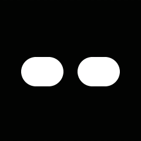</a></td>
<td align="center"><b>开心</b> <a href="media/screens/eyes-happy.gif">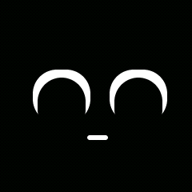</a></td>
<td align="center"><b>好奇</b> <a href="media/screens/eyes-curious.gif">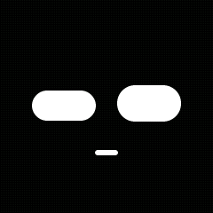</a></td>
</tr>
<tr>
<td align="center"><b>困倦</b> <a href="media/screens/eyes-sleepy.gif">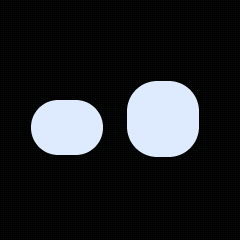</a></td>
<td align="center"><b>惊讶</b> <a href="media/screens/eyes-surprised.gif">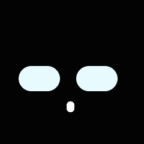</a></td>
<td align="center"><b>眨单眼</b> <a href="media/screens/eyes-winking.gif">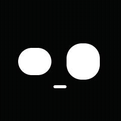</a></td>
</tr>
<tr>
<td align="center"><b>害羞</b> <a href="media/screens/eyes-shy.gif">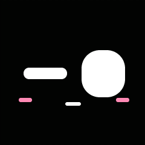</a></td>
<td align="center"><b>坚定</b> <a href="media/screens/eyes-confident.gif">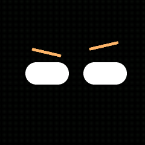</a></td>
</tr>
</table>

## 触摸陪伴与对话

短碰有方向反馈，单一区域持续约 650ms 进入摸头/揉脸，松手后渐渐恢复。

<table>
<tr>
<td align="center"><b>左侧受击</b> <a href="media/screens/eyes-hit-2.gif">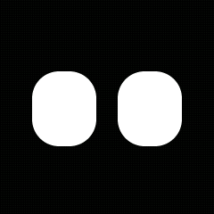</a></td>
<td align="center"><b>右侧受击</b> <a href="media/screens/eyes-hit-3.gif">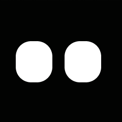</a></td>
<td align="center"><b>顶部受击</b> <a href="media/screens/eyes-hit-1.gif">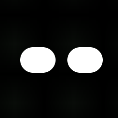</a></td>
</tr>
<tr>
<td align="center"><b>摸摸头</b> <a href="media/screens/eyes-pet-1.gif">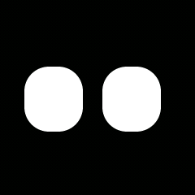</a></td>
<td align="center"><b>左侧揉脸</b> <a href="media/screens/eyes-pet-2.gif">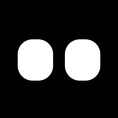</a></td>
<td align="center"><b>右侧揉脸</b> <a href="media/screens/eyes-pet-3.gif">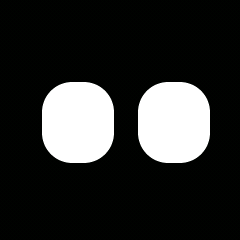</a></td>
</tr>
<tr>
<td align="center"><b>聆听/说话与字幕</b> <a href="media/screens/eyes-dialogue.gif">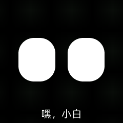</a></td>
</tr>
</table>

## 机甲双眼的配套反馈

<table>
<tr>
<td align="center"><b>机甲待机</b> <a href="media/screens/mecha-idle.gif">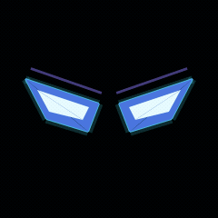</a></td>
<td align="center"><b>机甲对话光色</b> <a href="media/screens/mecha-dialogue.gif">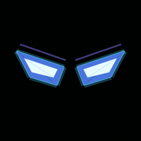</a></td>
<td align="center"><b>左侧受击</b> <a href="media/screens/mecha-hit-2.gif">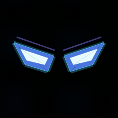</a></td>
</tr>
<tr>
<td align="center"><b>右侧受击</b> <a href="media/screens/mecha-hit-3.gif">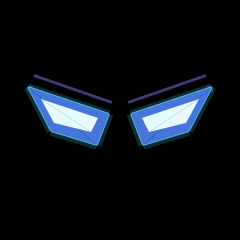</a></td>
<td align="center"><b>顶部受击</b> <a href="media/screens/mecha-hit-1.gif">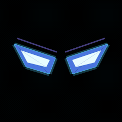</a></td>
<td align="center"><b>摸摸头</b> <a href="media/screens/mecha-pet-1.gif">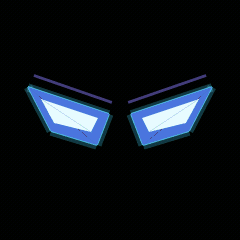</a></td>
</tr>
<tr>
<td align="center"><b>左侧揉脸</b> <a href="media/screens/mecha-pet-2.gif">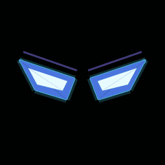</a></td>
<td align="center"><b>右侧揉脸</b> <a href="media/screens/mecha-pet-3.gif">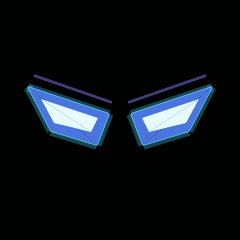</a></td>
</tr>
</table>

## 所有机身页面

<table>
<tr>
<td align="center"><b>双眼主页</b>  <small>常态眨眼和视线移动</small></td>
<td align="center"><b>机甲主页</b>  <small>光刃与呼吸光效</small></td>
<td align="center"><b>经典小智</b> <a href="media/screens/classic-xiaozhi.gif">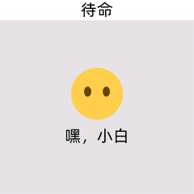</a> <small>切回原有表情/消息显示</small></td>
</tr>
<tr>
<td align="center"><b>应用列表</b> <a href="media/screens/page-menu.gif">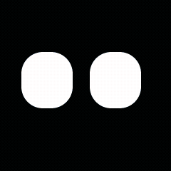</a> <small>单击切换，双击进入</small></td>
<td align="center"><b>木鱼</b> <a href="media/screens/page-muyu.gif">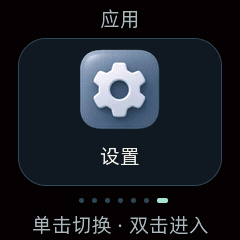</a> <small>点击计数与缩放反馈</small></td>
<td align="center"><b>骰子</b> <a href="media/screens/page-dice.gif">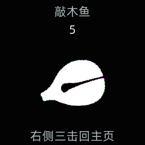</a> <small>摇动/点击掷骰</small></td>
</tr>
<tr>
<td align="center"><b>2048</b> <a href="media/screens/page-2048.gif">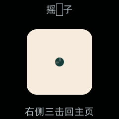</a> <small>倾斜或网页方向操作</small></td>
<td align="center"><b>摄像头</b> <a href="media/screens/page-camera.gif">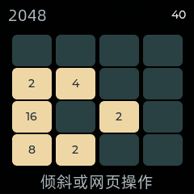</a> <small>本地预览；此处输入为预录示例</small></td>
<td align="center"><b>时钟</b> <a href="media/screens/page-clock.gif">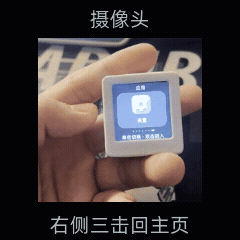</a> <small>联网校时；此处为示例时钟</small></td>
</tr>
<tr>
<td align="center"><b>海上航行</b> <a href="media/screens/page-voyage.gif">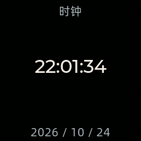</a> <small>三航道躲礁收集金币</small></td>
<td align="center"><b>设备设置</b> <a href="media/screens/page-settings.gif">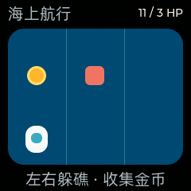</a> <small>网址、音量、样式和字幕</small></td>
<td align="center"><b>底座连接弹窗</b> <a href="media/screens/page-dock.gif">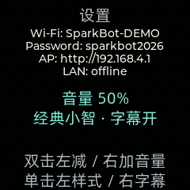</a> <small>连接反馈与双眼保持</small></td>
</tr>
<tr>
<td align="center"><b>页面切换</b> <a href="media/screens/page-transitions.gif">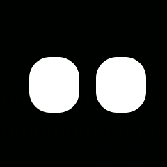</a> <small>主页、列表与应用间滑动</small></td>
</tr>
</table>

## 手机页面

手机部分直接加载设备内置网页，在 Edge 中切换真实控件并截图；设备状态使用本地示例数据，没有连接机器人。横屏截图展示相机与摇杆并排的布局。

<table>
<tr>
<td align="center"><b>遥控</b> <a href="media/phone/phone-remote.gif">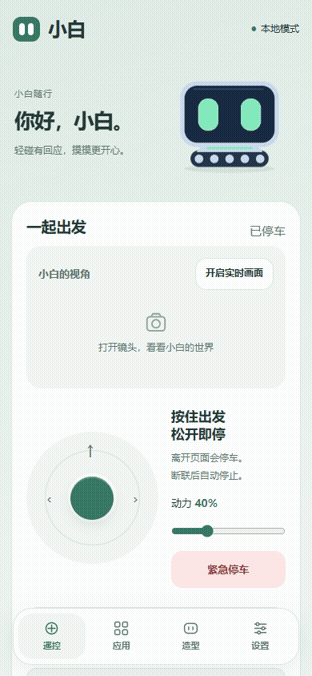</a></td>
<td align="center"><b>应用与玩法</b> <a href="media/phone/phone-apps.gif">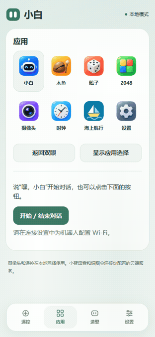</a></td>
</tr>
<tr>
<td align="center"><b>造型与底盘</b> <a href="media/phone/phone-look.gif">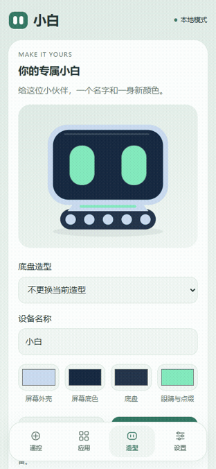</a></td>
<td align="center"><b>主题与设置</b> <a href="media/phone/phone-settings.gif">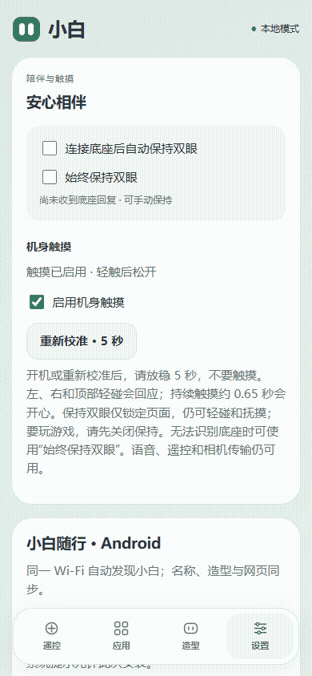</a></td>
</tr>
</table>

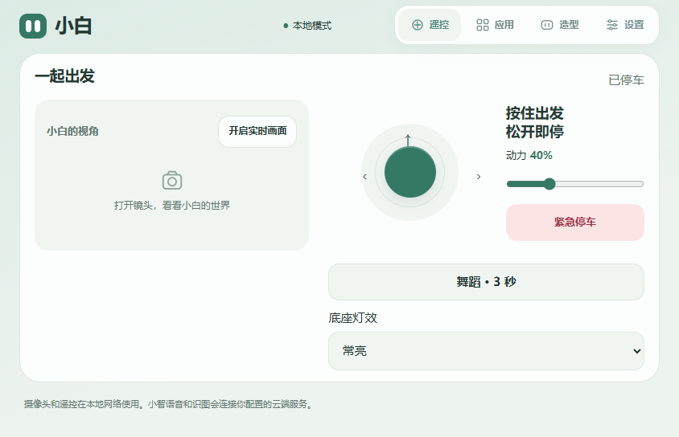

## 生成依据

- [渲染来源及源文件 SHA256](media/render-provenance.json)
- [机身 GIF 场景索引](media/screens/index.json)
- [手机页面来源说明](media/phone/provenance.json)
- [重放工具说明](../tools/visual-preview/README.md)

本次只补充演示媒体和说明，没有改变固件二进制、触摸参数或设备设置。
