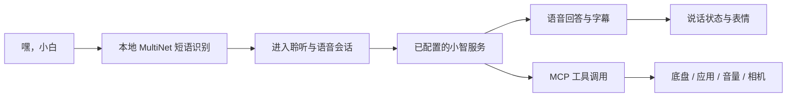

# 小智功能怎样并入小白

小白以小智 ESP32 固件 v1.9.4 为基础，保留语音会话程序、音频处理、联网协议和工具调用，再接入本项目的屏幕、应用、摄像头和底盘。小智在这套程序里负责对话与语言理解，机身的其他玩法由同一个固件管理。

## 一次对话的过程

### 唤醒与对话

- 唤醒短语为 **“嘿，小白”**，配置在 `sdkconfig.sparkbot`。本地使用 ESP-SR MultiNet 命令词模型识别该短语；它不是专门重新训练的 WakeNet 模型，识别率和误唤醒应按实物环境体验。
- 唤醒后保留小智的麦克风输入、音频编码/播放与服务会话。具体使用 MQTT 或 WebSocket，按设备收到的服务配置选择。
- 云端对话、角色和音色由用户配置的小智服务提供；本固件没有在手机 App 里附送另一套云模型账户或硬编码密钥。
- 机器人需要可联网的 2.4GHz Wi-Fi 和有效的小智服务配置。只有手机连到本地遥控热点，不代表机器人已经能进行云端对话。

示例：“嘿，小白，给我讲个故事”“嘿，小白，我们聊一会儿”。回答内容、延迟、可用音色与后台模型取决于使用的服务。

## 小智会怎样显示在屏幕上

| 状态 | 本项目的显示 |
| --- | --- |
| 待机 | 双眼呼吸、眨眼和视线移动，可短暂出现随机神态 |
| 聆听 | 双眼按聆听状态变化；启用字幕时可看到消息 |
| 说话 | 白眼样式出现嘴巴/眼形节奏，机甲样式有对应光色变化 |
| 服务下发表情 | `happy`、`thinking`、`sleepy` 等映射为现有表情；白眼有更丰富的形态，机甲主要跟随对话状态和触摸 |
| 字幕 | 设置中可开关；激活、错误等必要系统提示仍会显示 |
| 经典小智 | 可以切回原有消息/表情显示风格 |

进入连接、聆听或说话状态时，应用管理器会回到对话主页，避免把正在对话的反馈藏在小游戏后面。触摸表情只改变画面，不额外播放碰撞声音或控制底盘。

## 用对话控制底座

板级程序通过 MCP 注册下列动作。小智服务需要支持并启用工具调用；自然语言是否选中正确工具由服务端判断，不能把这些示例当成完全离线的固定口令。

| 可以这样表达 | 注册工具 | 设备动作 |
| --- | --- | --- |
| “向前走一下” | `self.chassis.go_forward` | 前进约半秒后自动停止 |
| “后退一点” | `self.chassis.go_back` | 后退约半秒后自动停止 |
| “向左转 / 向右转” | `self.chassis.turn_left` / `turn_right` | 对应转向约半秒 |
| “停下来” | `self.chassis.stop` | 停止坦克指令 |
| “跳个舞” | `self.chassis.dance` | 最长约三秒的可停止动作 |
| “换一个灯效” | `self.chassis.switch_light_mode` | 常亮、闪烁、呼吸、流光、灯光秀等 |

底盘沿用 UART 协议与现有停车保护。软件急停锁定时，需在手机上明确解除后才能再次移动；语音控制不绕过急停。机械惯性和硬件执行延迟仍需留出余量。

## 让小智打开应用、敲木鱼和摇骰子

| 能力 | 工具 |
| --- | --- |
| 打开小智、木鱼、骰子、2048、摄像头或时钟 | `self.entertainment.open` |
| 敲一次木鱼 | `self.entertainment.knock` |
| 掷骰子 | `self.entertainment.roll_dice` |
| 调扬声器音量 | `self.audio_speaker.set_volume` |

可以尝试“打开木鱼”“帮我敲一下木鱼”“摇个骰子”“把音量调低一些”。页面保持开启时，切换到其他应用会受到限制。航行游戏在本地应用管理器里可用，但当前工具说明仍主要列出上述基础应用，不承诺所有服务都能从名称自动找到新增游戏。

## 拍照识图与手机实时画面

二者共用同一个摄像头驱动，但用途不同：

1. **手机实时画面**：本地网络请求 JPEG 帧，在遥控页开关。画面不会因为开启预览就自动触发模型识图。
2. **小智识图**：`self.camera.take_photo` 按问题拍一张照片，再调用配置的视觉服务解释。可以表达“看看你面前是什么”。
3. **方向调整**：`self.camera.set_camera_flipped` 可翻转图像方向，设置保存在机器人上。

视觉服务地址由小智侧配置。未获得地址、相机不可用、服务连接失败或返回错误时，会报告失败；本地相机预览成功也不能证明识图服务已配置成功。

## 它们怎样同时使用

- 同一套固件、同一个主应用程序，不需要在对话、网页遥控和小游戏之间重新刷机。
- 机器人可连接上网 Wi-Fi，同时保留 `SparkBot-XXXX` 本地控制热点。
- 手机 App 主要提供设备发现和控制入口；AI 对话仍在机器人上执行录音、播放和工具动作。
- 木鱼与语音共用音量；已经处于说话状态时，木鱼额外音效会受到限制，避免与回答争抢声音。
- 相机、音频、屏幕和 Wi-Fi 共享 ESP32-S3 资源；源码有任务与锁管理，但本轮没有重新做云端对话/图传/运动同时运行的压力测试。

## 从哪里核对实现

- [自定义唤醒配置](../firmware/sdkconfig.sparkbot)
- [小智应用与消息处理](../firmware/main/application.cc)
- [底盘与娱乐 MCP 工具](../firmware/main/boards/esp-sparkbot/esp_sparkbot_board.cc)
- [共用摄像头及视觉服务](../firmware/main/boards/esp-sparkbot/hub_camera.cc)
- [语音状态与双眼表情](../firmware/main/boards/esp-sparkbot/sparkbot_display.cc)
- [应用管理与对话回主页](../firmware/main/boards/esp-sparkbot/sparkbot_hub.cc)
- [小智相机和音量工具](../firmware/main/mcp_server.cc)

这份说明依据当前发布源码整理。演示动图中的对话文字和状态是本地示例输入，用于展示 UI，不代表本轮发起了新的云端对话或识图测试。
